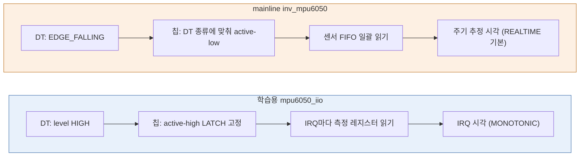

# MPU6050: IIO 채널·scale·IRQ 버퍼

- [1. 개요](#1-개요)
- [2. IIO를 쓰는 이유와 구현 구조](#2-iio를-쓰는-이유와-구현-구조)
- [3. 준비](#3-준비)
- [4. 단계별 재현](#4-단계별-재현)
- [5. 트러블슈팅](#5-트러블슈팅)
- [6. 미검증·한계](#6-미검증한계)

## 1. 개요

- **무엇을:** 직접 작성한 I2C 드라이버 [mpu6050_iio.c](mpu6050_iio.c)를 IIO에 등록해 6축 raw·고정 scale을 sysfs로 조회하고, GPIO17 Data Ready IRQ마다 6축과 IRQ 시각을 IIO 버퍼에 넣는다. [mpu6050_iio_app.c](mpu6050_iio_app.c)는 버퍼를 읽어 SI 단위 CSV를 기록한다.
- **범위:** 센서 설정은 100Hz·±2g·±250deg/s로 고정한다. 센서 FIFO·별도 커널 큐·범위 변경·자동 복구는 없다.
- **제외:** IIO에 센서 FIFO를 다시 연결하는 작업과 EIS 보완.
- **기존 예제와의 차이:** [FIFO 예제](../mpu6050/mpu6050.md)는 IRQ → 센서 FIFO → 자체 커널 큐 → misc read였다. 이번에는 사용자 인터페이스와 버퍼를 IIO에 맡긴다(→ [2장](#2-iio를-쓰는-이유와-구현-구조)). 두 드라이버를 같은 센서에 동시에 연결하지 않는다.

한 샘플이 센서에서 CSV까지 가는 흐름은 [4-5](#4-5-버퍼-수집)에 있다.

## 2. IIO를 쓰는 이유와 구현 구조

### 2-1. 왜 IIO인가

FIFO 예제는 문자 장치(misc) 위에서 사용자 인터페이스를 전부 직접 만들었다. 데이터 형식, 큐, 대기·깨우기, open 수명 관리, 단위 변환을 모두 드라이버와 앱이 약속해야 했다. IIO는 이 중 "센서와 무관한 부분"을 표준으로 제공하고, 드라이버는 **센서를 어떻게 읽는지만** 채운다.

| 필요한 기능 | misc 예제에서 직접 작성 | IIO가 제공 | IIO 예제의 드라이버가 하는 일 |
| --- | --- | --- | --- |
| 사용자 ABI | 자체 16B 구조체 [mpu6050_data.h#L7](../mpu6050/mpu6050_data.h#L7), misc 등록 [mpu6050_drv.c#L566](../mpu6050/mpu6050_drv.c#L566) | 표준 sysfs 이름(`in_accel_x_raw`)과 `scan_elements/*_type`으로 형식 공개 | 채널 선언 [mpu6050_iio.c#L64](mpu6050_iio.c#L64) |
| 단위 변환 | 앱에 16384·131 상수를 직접 씀 [mpu6050_app.c#L12](../mpu6050/mpu6050_app.c#L12) | `in_*_scale` 규약 | scale 반환 [mpu6050_iio.c#L85](mpu6050_iio.c#L85) |
| 샘플 큐 | 링 배열·head·queued·overrun 처리 [mpu6050_drv.c#L193](../mpu6050/mpu6050_drv.c#L193) | kfifo 버퍼, `buffer/length`·`watermark` | push 호출 [mpu6050_iio.c#L206](mpu6050_iio.c#L206) |
| 대기·깨우기 | wait queue [mpu6050_drv.c#L366](../mpu6050/mpu6050_drv.c#L366)·[L468](../mpu6050/mpu6050_drv.c#L468). poll은 미구현 [mpu6050_drv.c#L390](../mpu6050/mpu6050_drv.c#L390) | 버퍼 read/poll | 없음(앱이 poll 사용 [mpu6050_iio_app.c#L151](mpu6050_iio_app.c#L151)) |
| 수명·open 관리 | kref·단일 reader [mpu6050_drv.c#L288](../mpu6050/mpu6050_drv.c#L288)·[L281](../mpu6050/mpu6050_drv.c#L281) | 장치 파일·참조를 IIO 코어가 관리 | devm 할당 [mpu6050_iio.c#L310](mpu6050_iio.c#L310) |
| 수집 시작·중지 | probe에서 IRQ를 켜고 중지 함수를 직접 작성 [mpu6050_drv.c#L472](../mpu6050/mpu6050_drv.c#L472) | `buffer/enable` 쓰기 → 트리거 ops 호출 | set_trigger_state [mpu6050_iio.c#L126](mpu6050_iio.c#L126) |
| 타임스탬프 | 순번만 있고 시각 없음 [mpu6050_data.h#L8](../mpu6050/mpu6050_data.h#L8) | 소프트 타임스탬프 채널 + push_with_ts | [mpu6050_iio.c#L71](mpu6050_iio.c#L71)·[L166](mpu6050_iio.c#L166) |
| 채널 선택 | 항상 6축 고정 구조체 | `scan_elements/*_en` | scan mask [mpu6050_iio.c#L75](mpu6050_iio.c#L75) |
| 직접 읽기와 버퍼의 상호 배제 | 직접 읽기 경로 없음(mutex는 큐 보호용 [mpu6050_drv.c#L58](../mpu6050/mpu6050_drv.c#L58)) | `iio_device_claim_direct()` | [mpu6050_iio.c#L102](mpu6050_iio.c#L102) |

센서 FIFO 사용 여부는 IIO 전환과 별개의 차이다. 이번 예제는 FIFO 없이 Data Ready마다 측정 레지스터를 읽으며, IIO에 센서 FIFO를 붙이는 작업은 범위에서 제외했다.

IMU·ADC·압력 센서처럼 **샘플 단위 측정값**을 내는 장치는 커널에서 IIO로 다루는 것이 표준이다. 같은 센서의 mainline 드라이버 `drivers/iio/imu/inv_mpu6050/`도 IIO 드라이버다(대상 커널 `external/linux`에서 확인, 2026-11-10). mainline 드라이버는 regmap·runtime PM·센서 FIFO까지 지원하지만, 이 예제는 IIO의 뼈대를 배우기 위해 고정 범위 raw·scale과 FIFO 없는 버퍼만 직접 구현했다. 두 드라이버를 같은 센서에 번갈아 연결해 비교한 결과는 [2-4](#2-4-mainline-inv_mpu6050와의-차이)에 있다.

### 2-2. 구현 구조: 드라이버가 채우는 것과 IIO 코어가 해 주는 것

드라이버는 센서를 읽고 IRQ를 켜고 끄는 일만 하고, 속성 이름·데이터 형식·버퍼·장치 파일은 IIO 코어가 만든다. probe가 IIO에 알려 주는 순서대로 보면 다음과 같다.

| 순서 | 드라이버가 하는 일 | IIO 코어가 해 주는 일 | 사용자 공간에서 보이는 것 |
| --- | --- | --- | --- |
| ① iio_dev 할당 [L310](mpu6050_iio.c#L310) | 상태 구조체 크기 지정 | iio_dev와 드라이버 상태 영역 할당 | 아직 없음 |
| ② 채널 선언 [L64](mpu6050_iio.c#L64) | 타입·축·레지스터 주소·scan 형식 | 속성 이름 생성 | `in_*_raw`, `in_*_scale`, `scan_elements/*` |
| ③ read_raw [L77](mpu6050_iio.c#L77) | 레지스터 읽기, 값 형식 반환 | 문자열 변환 | `cat in_accel_x_raw` |
| ④ triggered buffer [L332](mpu6050_iio.c#L332) | 수집 콜백 지정 | kfifo·pollfunc 준비 | `buffer/`, `/dev/iio:deviceN` |
| ⑤ 트리거와 ops [L336](mpu6050_iio.c#L336)·[L126](mpu6050_iio.c#L126) | IRQ 켜기·끄기 | 버퍼 enable/disable 때 호출 | `trigger/current_trigger`, `buffer/enable` |
| ⑥ IRQ → poll_nested [L353](mpu6050_iio.c#L353)·[L181](mpu6050_iio.c#L181) | 시각 기록, 래치 해제 | 수집 콜백 실행 | `/proc/interrupts` |
| ⑦ push_with_ts [L206](mpu6050_iio.c#L206) | 6축 scan 구성 | 시각 삽입, kfifo 저장 | `read()`로 24B |
| ⑧ iio_device_register [L359](mpu6050_iio.c#L359) | 모든 준비 뒤 마지막에 호출 | sysfs·장치 파일 생성 | 위 항목 전부가 이 순간 나타남 |

**채널 선언 → sysfs 이름.** `iio_chan_spec`은 측정값이 아니라 "어떤 값을 어떤 이름·형식으로 공개할지"에 대한 설명이다.

```c
#define MPU6050_CHANNEL(_type, _axis, _reg, _index) { \
	.type = _type, .modified = 1, .channel2 = _axis, \
	.address = _reg, \
	.info_mask_separate = BIT(IIO_CHAN_INFO_RAW), \
	.info_mask_shared_by_type = BIT(IIO_CHAN_INFO_SCALE), \
	.scan_index = _index, \
	.scan_type = { .sign = 's', .realbits = 16, .storagebits = 16, .endianness = IIO_BE }, \
}
```

(가독성을 위해 줄을 합친 발췌. 원문 [L48](mpu6050_iio.c#L48))

- `type` + `channel2`(X/Y/Z)로 IIO 코어가 `in_accel_x`, `in_anglvel_z` 같은 이름을 만든다.
- `info_mask_separate`의 RAW는 축마다 `_raw` 속성을, `info_mask_shared_by_type`의 SCALE은 종류마다 `_scale` 하나를 만든다.
- `.address`는 축의 측정 레지스터(0x3b 등)이고 DT의 I2C 주소 0x68과 다르다. 여섯 축이 이 값만 다르므로 read_raw 하나로 처리된다.
- `scan_index`·`scan_type`은 버퍼에서의 순서와 저장 형식이며 `scan_elements/*_index`, `*_type`으로 공개된다.

read_raw는 측정값을 `*val`에 쓰고 **값의 형식**(`IIO_VAL_INT` 등)을 반환한다. 문자열 변환은 IIO가 하므로 드라이버에 `sprintf`·`copy_to_user`가 없다.

**버퍼·트리거·pollfunc의 관계.** 세 가지는 역할이 다르다.

- **버퍼**(kfifo)는 샘플을 쌓아 두는 곳이다. `iio_triggered_buffer_setup()`이 kfifo와 함께 **pollfunc**를 만든다. pollfunc는 "트리거가 오면 실행할 수집 콜백(trigger_handler)과 그 샘플의 시각"을 담은 구조다.
- **트리거**는 "지금 한 샘플을 수집하라"는 이벤트 출처다. 이 예제에서는 GPIO17 Data Ready IRQ가 트리거를 발생시킨다.
- `buffer/enable`에 1을 쓰면 IIO 코어가 pollfunc를 현재 트리거에 연결하고 트리거 ops의 `set_trigger_state(true)`를 부른다. 그 뒤 IRQ thread가 `iio_trigger_poll_nested()`를 호출할 때마다 연결된 pollfunc의 수집 콜백이 실행된다.
- 트리거를 `iio_trigger_set_immutable()`([L348](mpu6050_iio.c#L348))과 `validate_own_device`([L158](mpu6050_iio.c#L158))로 이 장치 전용으로 고정했다. `current_trigger`로 이름은 볼 수 있지만 다른 트리거로 바꿀 수 없다.

**직접 읽기와 버퍼의 상호 배제.** sysfs raw 조회와 버퍼 수집이 동시에 센서를 읽으면 I2C 전송이 섞인다. read_raw의 RAW 경로는 `iio_device_claim_direct()`로 "버퍼가 꺼져 있을 때만" 들어간다. 버퍼가 켜져 있으면 false가 반환되어 `-EBUSY`로 끝난다. 그래서 드라이버에 별도 mutex가 없다. 대상 커널의 이 API는 bool을 반환하며, 예전 `claim_direct_mode`(int 반환)와 다르다. 성공한 claim은 오류 경로에서도 release와 짝을 이룬다. 버퍼 상태에 따른 실제 결과는 [4-4](#4-4-rawscale-조회)에 있다.

### 2-3. 구현 순서와 재현 단계의 대응

- Makefile로 모듈·overlay·앱 빌드, 배포 → [4-1](#4-1-빌드)·[4-2](#4-2-배포)
- overlay로 I2C client 생성 → probe에서 ①~⑧ 등록 → [4-3](#4-3-overlay-적용--probe)
- 채널 → read_raw → sysfs로 확인 → [4-4](#4-4-rawscale-조회)
- 버퍼·트리거·타임스탬프 → 앱으로 연속 수집 → [4-5](#4-5-버퍼-수집)
- 버퍼 중지와 등록 역순 해제 → [4-6](#4-6-중지정리)
- 같은 센서를 mainline 드라이버로 연결해 비교 → [2-4](#2-4-mainline-inv_mpu6050와의-차이)·[4-7](#4-7-mainline-inv_mpu6050로-같은-센서-읽기)

### 2-4. mainline `inv_mpu6050`와의 차이

같은 GY-521(I2C1 0x68, INT GPIO17)을 학습용 드라이버 대신 대상 커널의 `inv_mpu6050`에 연결했다. DT는 rpi `i2c-sensor` overlay의 `mpu6050` 파라미터를 썼다. 두 드라이버 모두 IIO 장치를 만들지만 **IRQ 설정을 누가 정하는지, 샘플을 어디서 꺼내는지, 시각을 어떻게 붙이는지**가 다르다.



| 항목 | 학습용 `mpu6050_iio.c` | mainline `inv_mpu6050` | 근거 |
| --- | --- | --- | --- |
| 바인딩·이름 | `mpu6050-iio-study` | 드라이버 `inv-mpu6050-i2c`, IIO `name` = `mpu6050`, trigger `mpu6050-dev0` | 실측 |
| 채널 | 6축 + timestamp | 6축 + 온도 + timestamp (`in_temp_*`, `calibbias`, `mount_matrix` 추가) | 실측(sysfs 목록) |
| scan index | accel 0~2, gyro 3~5, timestamp 6 | accel 0~2, temp 3, gyro 4~6, timestamp 7. 형식은 같다(`be:s16/16>>0`, `le:s64/64>>0`) | 실측 |
| 초기 범위·scale | ±2 g `0.000598550`, ±250 deg/s `0.000133231` 고정 | ±2 g `0.000598`, **±2000 deg/s** `0.001064724`. `*_scale_available`로 변경 가능 | 실측 |
| 주파수 | 공칭 100 Hz 고정 | `sampling_frequency` = 50, 10~500 Hz로 변경 가능 | 실측(50)·읽기 확인(범위, `inv_mpu_core.c` L1687) |
| IRQ 종류 | 드라이버가 `IRQF_TRIGGER_HIGH` 지정, 칩 LATCH ([mpu6050_iio.c#L353](mpu6050_iio.c#L353)) | DT의 종류를 `irq_get_trigger_type()`으로 읽어 칩 INT_PIN_CFG를 맞춤. 이번 overlay는 falling → active-low, 비래치 | 실측(`/proc/interrupts` `17 Edge inv_mpu`)·읽기 확인(`inv_mpu_core.c` L1922) |
| IRQ 없을 때 | `request_threaded_irq()` 실패 시 probe 실패로 정리 ([mpu6050_iio.c#L353](mpu6050_iio.c#L353)) | raw·scale은 동작하지만 **trigger·buffer를 만들지 않음** | 학습용은 읽기 확인(미실측). mainline은 실측([5장](#실행-중-dtoverlay로-적용한-mainline-장치에-buffer가-없음))·읽기 확인(`inv_mpu_core.c` L2086) |
| timestamp 출처 | hard IRQ의 `iio_get_time_ns()`, CLOCK_MONOTONIC 지정 ([mpu6050_iio.c#L324](mpu6050_iio.c#L324)) | IRQ 시각과 칩 클럭 주기로 `inv_sensors_timestamp`가 샘플별 시각을 계산. 시계 지정이 없어 IIO 기본값 CLOCK_REALTIME | 실측(값이 수집 시점의 epoch ns, 간격 20.00~20.02 ms)·읽기 확인 |
| FIFO | 센서 FIFO 없음. IRQ 1번에 샘플 1개 | 센서 FIFO에서 완전한 샘플을 일괄로 읽고 overflow가 임박하면 FIFO 재설정 | 읽기 확인(`inv_mpu_ring.c`). 이번 실측은 IRQ 5번에 샘플 5개라 여러 샘플 일괄 읽기는 관찰하지 못함 |

**해석 시 주의.** gyro 초기 범위가 다르므로 raw를 바로 비교하지 않는다. 각 드라이버 sysfs의 raw × scale(SI 단위)로 비교한다. 정지 자세 가속도는 60초 기준선과 1% 이내로 맞지만, 축별 차이가 노이즈 범위 안인지는 판정하지 않았다([6장](#6-미검증한계)).

**왜 DT가 칩 설정까지 정하는가.** INT 핀의 극성과 래치는 칩 레지스터 설정이고, GPIO 컨트롤러가 어떤 변화를 IRQ로 볼지는 DT `interrupts`의 둘째 셀이다. 둘이 짝이 맞아야 IRQ가 들어온다. 학습용 드라이버는 둘을 코드에 고정했고, mainline은 DT 값에 칩을 맞춘다. 그래서 보드마다 배선이나 레벨 변환이 달라도 DT만 고치면 된다.

## 3. 준비

| 항목 | 값 |
| --- | --- |
| 보드·커널 | Pi 4, `6.18.59-v8-bsp-study01` (구축 과정: [커널 구축](../../docs/kernel-build.md)) |
| WSL 커널 빌드 디렉터리 | `~/bspworkspace/bsp-study/out/kernel-rpi4` ([Makefile](Makefile)의 KDIR 기본값). `.config`에 `CONFIG_IIO=m` |
| 배선 | [bringup.md 모듈과 핀 연결표](../../docs/bringup.md#모듈과-핀-연결표). SDA/SCL·전원과 INT → GPIO17(물리 11) |
| 도구 | ARM64 크로스 GCC, SSH 별칭 `pi` |

```bash
# [WSL] ~/bspworkspace/bsp-study
grep '^CONFIG_IIO=' out/kernel-rpi4/.config      # CONFIG_IIO=m
```

```bash
# [Pi] ~ — 배포 디렉터리와 기존 FIFO 드라이버 미적재 확인
mkdir -p ~/bsp/modules ~/bsp/overlays ~/bsp/apps
uname -r                                     # 6.18.59-v8-bsp-study01
sudo dtoverlay -l                            # mpu6050-overlay가 없어야 함
lsmod | grep -E '^mpu6050_(drv|iio) '        # 출력 없음
ls -ld /sys/bus/i2c/devices/1-0068           # No such file or directory
```

기존 FIFO 예제가 남아 있으면 앱을 종료하고 `sudo dtoverlay -r mpu6050-overlay` → `sudo rmmod mpu6050_drv` 순서로 정리한다. 바인딩 중인 센서에 i2ctransfer 등으로 직접 접근하지 않는다.

## 4. 단계별 재현

### 4-1. 빌드

**목적:** 모듈·overlay·앱을 ARM64용으로 만든다.

```bash
# [WSL] ~/bspworkspace/bsp-study/examples/mpu6050_iio
make
file mpu6050_iio.ko mpu6050_iio_app
modinfo -F vermagic ./mpu6050_iio.ko
modinfo -F depends ./mpu6050_iio.ko
```

**관련 코드**
- [Makefile#L1](Makefile#L1) — KERNELRELEASE 분기(Kbuild가 다시 읽을 때 obj-m만 본다)
- [Makefile#L4](Makefile#L4) — KDIR·ARCH·CROSS_COMPILE·APP_CC·DTC 변수
- [Makefile#L17](Makefile#L17) — all → modules / overlay / app 타깃

**확인 포인트**
- 두 파일 모두 `ELF 64-bit ... ARM aarch64`
- vermagic이 `6.18.59-v8-bsp-study01`로 시작
- depends = `industrialio,industrialio-triggered-buffer`

**설명:** `make`를 처음 실행하면 KERNELRELEASE가 비어 있어 else 쪽 타깃이 동작한다. modules 타깃은 커널 빌드 디렉터리의 Makefile을 `M=`으로 호출하고, Kbuild는 이 Makefile을 KERNELRELEASE가 설정된 상태로 다시 읽어 `obj-m`만 사용한다. overlay는 커널 트리의 dtc로 `-@`(라벨 심볼 포함) 컴파일하고, 앱은 APP_CC로 크로스 빌드한다.

### 4-2. 배포

**목적:** 빌드 결과를 Pi의 `~/bsp/` 아래로 보낸다. 로드·overlay 적용은 하지 않는다.

```bash
# [WSL] ~/bspworkspace/bsp-study/examples/mpu6050_iio
make deploy
```

**관련 코드**
- [Makefile#L10](Makefile#L10) — 대상 호스트 `pi`와 Pi 쪽 디렉터리
- [Makefile#L33](Makefile#L33) — ko·dtbo·앱·imu_plot.py를 scp

**확인 포인트:** scp 4건이 오류 없이 끝나고 `~/bsp/modules/mpu6050_iio.ko`, `~/bsp/overlays/mpu6050-iio-overlay.dtbo`, `~/bsp/apps/{mpu6050_iio_app,imu_plot.py}`가 있다.

### 4-3. overlay 적용 → probe

**목적:** I2C client를 만들어 드라이버를 바인딩하고, probe가 [2-2의 ①~⑧](#2-2-구현-구조-드라이버가-채우는-것과-iio-코어가-해-주는-것)을 등록해 IIO 장치를 공개한다.

```bash
# [Pi] ~/bsp/modules
cd ~/bsp/modules
sudo modprobe industrialio_triggered_buffer
sudo insmod ./mpu6050_iio.ko
```

modprobe가 실패하면 insmod를 실행하지 않는다. 먼저 `/lib/modules/$(uname -r)`에 대상 커널 모듈이 설치됐는지 확인한다. modprobe는 의존 모듈(industrialio)까지 함께 올리지만 insmod는 의존성을 해결하지 않는다.

```bash
# [Pi] ~/bsp/overlays
cd ~/bsp/overlays
sudo dtoverlay -d "$PWD" mpu6050-iio-overlay
readlink -e /sys/bus/i2c/devices/1-0068/driver
sudo dmesg | grep -F 'mpu6050-iio-study' | tail -1
grep -F 'mpu6050-iio-data-ready' /proc/interrupts
```

**관련 코드**
- [mpu6050-iio-overlay.dts#L7](mpu6050-iio-overlay.dts#L7) — GPIO17 pinctrl(입력, 풀다운)
- [mpu6050-iio-overlay.dts#L29](mpu6050-iio-overlay.dts#L29) — client 노드: compatible·reg·pinctrl-0·`interrupts = <17 4>`
- [mpu6050_iio.c#L391](mpu6050_iio.c#L391) — of_match(compatible)·i2c_driver 등록
- [mpu6050_iio.c#L294](mpu6050_iio.c#L294) — probe 사전 검사: DT IRQ·I2C 기능·WHO_AM_I
- [mpu6050_iio.c#L310](mpu6050_iio.c#L310) — iio_dev 할당·필드 설정·monotonic 클록
- [mpu6050_iio.c#L233](mpu6050_iio.c#L233) — 센서 초기화(100Hz·±2g·±250deg/s·INT LATCH)
- [mpu6050_iio.c#L332](mpu6050_iio.c#L332) — triggered buffer·트리거 할당/등록/immutable
- [mpu6050_iio.c#L352](mpu6050_iio.c#L352) — request_threaded_irq(NO_AUTOEN)·iio_device_register·ready 로그
- [mpu6050_iio.c#L366](mpu6050_iio.c#L366) — probe 실패 시 역순 정리

**확인 포인트**
- driver 링크 = `/sys/bus/i2c/drivers/mpu6050-iio-study`
- `[IIO] ready: raw + scale + IRQ timestamp buffer, scan=24 bytes`
- `/proc/interrupts`에 GPIO17 Level `mpu6050-iio-data-ready` 행이 있고 횟수는 0

초기화에 100ms 대기가 두 번 있어 driver 링크가 먼저 보이고 ready 로그가 늦게 나올 수 있다. 잠시 뒤 다시 확인한다.

**설명 — `interrupts = <17 4>`와 pinctrl:** `interrupt-parent = <&gpio>`이므로 GPIO 컨트롤러가 이 IRQ를 해석한다. 첫 셀 17은 BCM GPIO 번호, 둘째 셀 4는 `IRQ_TYPE_LEVEL_HIGH`다. 커널이 이를 Linux IRQ 번호로 바꿔 `client->irq`에 넣는다. `pinctrl-0`이 가리키는 노드는 GPIO17을 입력·풀다운으로 설정하며, 드라이버 바인딩 시 "default" 상태로 적용된다. INT 선이 떠 있을 때 HIGH로 오인하지 않게 하는 설정이다.

**설명 — IRQF_NO_AUTOEN:** `request_threaded_irq()`는 보통 등록 즉시 IRQ를 켠다. 이 드라이버는 버퍼를 켤 때만 IRQ가 필요하므로 NO_AUTOEN으로 꺼진 상태로 등록한다. 켜고 끄는 일은 4-5의 set_trigger_state(`enable_irq()`)와 4-6(`disable_irq()`)에서 짝을 맞춰 한다. 등록 직후 IRQ 횟수가 0인 이유다.

### 4-4. raw·scale 조회

**목적:** 버퍼가 꺼진 상태에서 sysfs로 축별 raw와 scale을 읽는다. 채널 선언과 read_raw의 역할은 [2-2](#2-2-구현-구조-드라이버가-채우는-것과-iio-코어가-해-주는-것)에 있다.

```bash
# [Pi] ~ — 새 터미널에서도 첫 줄부터 실행한다. 장치 번호를 0으로 고정하지 않는다.
cd ~
imu_iio_path=$(grep -lx 'mpu6050-iio-study' /sys/bus/iio/devices/iio:device*/name | xargs -r dirname)
echo "IIO path: $imu_iio_path"
for ch in accel_x accel_y accel_z anglvel_x anglvel_y anglvel_z; do
    printf '%s: ' "$ch"; cat "$imu_iio_path/in_${ch}_raw"
done
cat "$imu_iio_path/in_accel_scale" "$imu_iio_path/in_anglvel_scale"
cat "$imu_iio_path/current_timestamp_clock" "$imu_iio_path/scan_elements/in_timestamp_type"
```

**관련 코드**
- [mpu6050_iio.c#L39](mpu6050_iio.c#L39) — scale nano 상수
- [mpu6050_iio.c#L48](mpu6050_iio.c#L48) — 채널 매크로·6축+timestamp 배열
- [mpu6050_iio.c#L85](mpu6050_iio.c#L85) — SCALE 분기(IIO_VAL_INT_PLUS_NANO)
- [mpu6050_iio.c#L100](mpu6050_iio.c#L100) — RAW 분기: claim_direct → 2바이트 읽기 → release

**확인 포인트**
- 경로가 `/sys/bus/iio/devices/iio:deviceN`. 비어 있으면 4-3부터 확인
- raw 6개가 -32768~32767 정수이고 자세를 바꾸면 변한다
- scale `0.000598550`, `0.000133231` / clock `monotonic` / timestamp type `le:s64/64>>0`

**설명 — scale 표현:** `IIO_VAL_INT_PLUS_NANO`는 `val + val2 / 1,000,000,000`이다. 커널에서 부동소수점을 쓰지 않고 정수 두 개로 소수 계수를 낸다.

| 속성 | 계산 | val, val2 | 단위 |
| --- | --- | --- | --- |
| `in_accel_scale` | 9.80665 / 16384 = 0.000598550… | 0, 598550 | raw × scale → m/s² |
| `in_anglvel_scale` | (π / 180) / 131 = 0.000133231… | 0, 133231 | raw × scale → rad/s |

16384와 131은 ±2g·±250deg/s 범위의 LSB 감도다. scale은 raw를 자동 변환하지 않으므로 곱셈은 사용자 공간에서 한다. g·deg/s로 비교하려면 m/s²를 9.80665로 나누거나 rad/s에 180/π를 곱한다. 영점·감도 보정은 없다.

**설명 — 버퍼 OFF/ON일 때 sysfs 읽기:** [2-2의 상호 배제](#2-2-구현-구조-드라이버가-채우는-것과-iio-코어가-해-주는-것) 때문에 같은 `cat`도 버퍼 상태에 따라 결과가 다르다.

| 조회 | 버퍼 OFF | 버퍼 ON |
| --- | --- | --- |
| `in_*_raw` | claim 성공 → I2C 2B 읽기 → 정수 | claim 실패 → `-EBUSY`(`Device or resource busy`) |
| `in_*_scale` | 상수 반환 | 상수 반환(claim 전에 처리) |

6개 raw 속성을 차례로 읽으면 전송 시점이 각각 다르므로 같은 순간의 6축 샘플이 아니다. 같은 시점의 6축은 4-5의 버퍼로 얻는다.

### 4-5. 버퍼 수집

**목적:** IRQ마다 6축과 시각을 버퍼로 받아 CSV에 기록한다. 버퍼 설정·시작·중지는 앱이 직접 한다.

한 샘플은 다음 순서로 흐른다. hard IRQ에서는 잠들 수 없어 시각만 기록하고, I2C 전송은 모두 IRQ thread에서 한다.

| 순서 | 문맥 | 일어나는 일 |
| --- | --- | --- |
| 1 | 하드웨어 | 새 데이터 준비 → INT HIGH(래치 유지) |
| 2 | hard IRQ | `mpu6050_irq`: IRQ 관측 시각 기록 |
| 3 | IRQ thread | `mpu6050_irq_thread`: INT_STATUS 읽기(래치 해제) → `iio_trigger_poll_nested()` |
| 4 | IRQ thread | `mpu6050_trigger_handler`: 14B 읽기 → 온도 제외 → 6축+시각 24B를 kfifo에 push |
| 5 | 사용자 공간 | 앱: `read()` 24B → raw × scale → CSV 한 줄 |

```bash
# [Pi] ~/bsp/apps — 약 10초 관찰 후 Ctrl+C
cd ~/bsp/apps
./mpu6050_iio_app            # IIO 설정 쓰기 권한 오류면 sudo ./mpu6050_iio_app
echo $?
sudo dmesg | grep -F 'mpu6050-iio-study' | tail -2
```

**관련 코드 — 앱이 버퍼를 켜기까지**
- [mpu6050_iio_app.c#L124](mpu6050_iio_app.c#L124) — check_scan: index 0~6·type·clock 확인
- [mpu6050_iio_app.c#L258](mpu6050_iio_app.c#L258) — 이미 켜진 버퍼면 건드리지 않고 종료
- [mpu6050_iio_app.c#L110](mpu6050_iio_app.c#L110) — prepare_buffer: 7채널·length 128·watermark 1
- [mpu6050_iio_app.c#L318](mpu6050_iio_app.c#L318) — buffer/enable=1

**관련 코드 — 드라이버의 수집 경로**
- [mpu6050_iio.c#L143](mpu6050_iio.c#L143) — set_trigger_state 켜기: INT_STATUS 정리 → INT_ENABLE → enable_irq
- [mpu6050_iio.c#L161](mpu6050_iio.c#L161) — primary IRQ: 시각만 기록
- [mpu6050_iio.c#L170](mpu6050_iio.c#L170) — IRQ thread: INT_STATUS 읽어 래치 해제 → poll_nested
- [mpu6050_iio.c#L186](mpu6050_iio.c#L186) — trigger_handler: 14B 읽기 → 온도 제외 → push_with_ts → notify_done
- [mpu6050_iio.c#L74](mpu6050_iio.c#L74) — available_scan_masks(하드웨어 수집은 항상 6축)

**관련 코드 — 앱이 scan을 해석**
- [mpu6050_iio_app.c#L151](mpu6050_iio_app.c#L151) — read_sample: poll 최대 5초 → 24바이트 read
- [mpu6050_iio_app.c#L187](mpu6050_iio_app.c#L187) — decode_axis: big-endian 2바이트 → int16
- [mpu6050_iio_app.c#L342](mpu6050_iio_app.c#L342) — timestamp(오프셋 16) 복사·scale 곱

**확인 포인트**
- `=== OPEN ===` 다음에 `device: /dev/iio:deviceN`, `CSV: /home/<사용자>/bsp/logs/YYYYMMDD-HHMMSS_mpu6050.csv`
- 약 1초마다 표 한 행이 나오고 Samples가 초당 약 100씩 증가하며, 센서를 움직이면 값이 반응한다
- Ctrl+C 후 `=== CLOSE ===`·`samples: N`, `echo $?` = 0. dmesg는 `[BUFFER] enabled: 100 Hz nominal` → `[BUFFER] disabled`(드라이버 로그 문자열 그대로)

CSV 첫 줄은 `time_s,ax_m_s2,ay_m_s2,az_m_s2,gx_rad_s,gy_rad_s,gz_rad_s`이다. 값은 첫 IRQ부터의 경과 초와 SI 6축을 소수 둘째 자리로 기록한다. 앱은 `~/bsp/logs`를 직접 만들고, sudo로 실행해도 원래 사용자의 홈에 기록하며, 같은 이름의 파일은 덮어쓰지 않는다(`fopen "wx"`). 수집 중 다른 터미널에서 `cat "$imu_iio_path/in_accel_x_raw"`를 실행하면 4-4의 표대로 `Device or resource busy`가 예상된다.

**정해진 시간만 수집(정지 기준선):** 센서를 고정해 두고 Ctrl+C 대신 `timeout`으로 SIGINT를 보낸 뒤 CSV에서 축별 평균·표준편차와 간격을 계산한다. 결과는 [6장](#6-미검증한계)에 있다.

```bash
# [Pi] ~/bsp/apps — 4-3 적용 후. --preserve-status가 없으면 timeout이 앱 종료 코드 대신 124를 반환한다
cd ~/bsp/apps
sudo timeout --preserve-status -s INT 60 ./mpu6050_iio_app; echo "exit=$?"
f=$(ls -t ~/bsp/logs/*_mpu6050.csv | head -1)
awk -F, 'NR==1{for(i=2;i<=7;i++)h[i]=$i;next}
 {n++; for(i=2;i<=7;i++){s[i]+=$i;q[i]+=$i*$i}
  if(n>1){d=$1-p; ds+=d; if(d>mx)mx=d; if(mn==""||d<mn)mn=d} p=$1}
 END{printf "samples=%d duration=%.2fs\n",n,p;
  for(i=2;i<=7;i++){m=s[i]/n; printf "%-10s mean=%9.4f std=%8.4f\n",h[i],m,sqrt(q[i]/n-m*m)}
  printf "dt mean=%.4fs min=%.2fs max=%.2fs\n",ds/(n-1),mn,mx}' "$f"
```

CSV 시각은 10ms 단위로 잘리므로 간격 min/max는 반올림 영향을 받는다. 개별 간격 분포 판단에는 쓰지 않는다.

**설명 — primary와 thread 분리, LATCH + IRQF_ONESHOT:** primary 핸들러는 hard IRQ 문맥이라 잠들 수 없다. I2C 전송은 잠들 수 있으므로 thread로 미루고, primary에서는 시각만 가능한 한 빨리 기록한다.

```c
static irqreturn_t mpu6050_irq(int irq, void *private)
{
	struct iio_dev *indio_dev = private;

	indio_dev->pollfunc->timestamp = iio_get_time_ns(indio_dev);
	return IRQ_WAKE_THREAD;
}
```

센서는 LATCH 설정이라 INT_STATUS를 읽을 때까지 INT를 HIGH로 유지한다. 레벨 HIGH IRQ에서 래치를 풀기 전에 선을 다시 허용하면 같은 IRQ가 반복해서 들어온다. 그래서 `IRQF_ONESHOT`으로 thread가 끝날 때까지 선을 막아 둔다. `iio_trigger_poll_nested()`는 수집 콜백을 같은 thread에서 동기로 실행한다. 따라서 다음 IRQ가 `pollfunc->timestamp`를 덮어쓰기 전에 그 샘플의 시각이 버퍼로 들어가며, 별도 잠금이 필요 없다. 수집 콜백은 성공·실패 모두 `iio_trigger_notify_done()`을 호출해야 다음 트리거를 받는다.

**설명 — 24바이트 scan 구조:** 센서는 0x3b부터 가속도 6B·온도 2B·자이로 6B를 연속으로 내므로 14B를 한 번에 읽고 온도만 건너뛴다.

```c
IIO_DECLARE_BUFFER_WITH_TS(__be16, scan, 6) = { };
memcpy(scan, raw, 6);           /* accel X/Y/Z */
memcpy(&scan[3], &raw[8], 6);   /* gyro X/Y/Z, 온도 raw[6..7] 제외 */
iio_push_to_buffers_with_ts(indio_dev, scan, sizeof(scan), pf->timestamp);
```

| 바이트 | scan_index | 값 | 형식 |
| --- | --- | --- | --- |
| 0~5 | 0 / 1 / 2 | 가속도 X / Y / Z | `be:s16/16>>0` |
| 6~11 | 3 / 4 / 5 | 자이로 X / Y / Z | `be:s16/16>>0` |
| 12~15 | 없음 | 패딩(0) | timestamp를 8바이트 경계에 맞춤 |
| 16~23 | 6 | IRQ 관측 시각(ns) | `le:s64/64>>0` |

6축은 센서 바이트 순서(big-endian)를 그대로 버퍼에 넣고 앱이 해석한다. timestamp는 CPU native endian이라 Pi에서는 little-endian이다. 12+8=20이 아니라 정렬 때문에 24바이트이며, `{ }` 초기화로 패딩도 0이 된다. 이 시각은 센서의 측정 시각이 아니라 **CPU가 primary 핸들러를 실행한 시각**이다.

(선택) C 앱을 종료한 뒤 Pi 데스크톱 터미널에서 `sudo --preserve-env=DISPLAY,XAUTHORITY,WAYLAND_DISPLAY,XDG_RUNTIME_DIR python3 ~/bsp/apps/imu_plot.py`를 실행하면 같은 버퍼를 직접 읽어 최근 10초 그래프를 보여준다(python3-matplotlib·python3-tk 필요, 창을 닫으면 버퍼 중지, C 앱과 동시 실행 금지).

### 4-6. 중지·정리

**목적:** 버퍼가 꺼졌는지 확인하고 장치·모듈을 제거한다.

```bash
# [Pi] ~ — imu_iio_path는 4-4에서 설정(새 터미널이면 4-4의 cd·imu_iio_path 두 줄을 다시 실행)
cd ~
cat "$imu_iio_path/buffer/enable"            # 0
cat "$imu_iio_path/in_accel_x_raw"           # 정수(raw 조회 재개)
# 앱이 강제 종료돼 1이 남았다면: printf '0\n' | sudo tee "$imu_iio_path/buffer/enable"

# [Pi] ~/bsp/overlays
cd ~/bsp/overlays
sudo dtoverlay -r mpu6050-iio-overlay
ls -ld /sys/bus/i2c/devices/1-0068 "$imu_iio_path"   # 둘 다 No such file or directory
grep -F 'mpu6050-iio-data-ready' /proc/interrupts    # 출력 없음
sudo dmesg | grep -F 'mpu6050-iio-study' | tail -1

# [Pi] ~/bsp/modules
cd ~/bsp/modules
sudo rmmod mpu6050_iio
lsmod | grep '^mpu6050_iio '                         # 출력 없음
```

**관련 코드**
- [mpu6050_iio_app.c#L383](mpu6050_iio_app.c#L383) — 앱 종료 경로의 buffer/enable=0
- [mpu6050_iio.c#L133](mpu6050_iio.c#L133) — set_trigger_state 끄기: disable_irq → INT_ENABLE=0
- [mpu6050_iio.c#L377](mpu6050_iio.c#L377) — remove: 등록의 역순 정리
- [mpu6050_iio.c#L275](mpu6050_iio.c#L275) — 센서 슬립

**확인 포인트**
- buffer/enable = `0`, raw는 정수
- dmesg 마지막 줄 `[REMOVE] detached`, 장치 경로·IRQ 행·모듈 모두 없음

장치 파일을 close한다고 버퍼가 꺼지지는 않는다. 앱은 Ctrl+C·SIGTERM·오류 시 공통 종료 경로에서 0을 쓰며, SIGKILL·전원 차단에서는 이를 보장하지 않는다. 버퍼를 끌 때 `disable_irq()`가 진행 중인 IRQ thread와 수집 콜백이 끝날 때까지 기다린 뒤 센서 알림을 끈다. 이 I2C 쓰기가 실패해도 Linux IRQ는 이미 막혀 있으므로 경고만 남기고 0을 반환해 IIO의 정리를 진행시킨다. industrialio 계열 공통 모듈은 다른 장치가 쓸 수 있어 내리지 않는다.

**설명 — remove가 등록의 역순인 이유:** probe는 버퍼 → 트리거 → IRQ → `iio_device_register()`(사용자 공개) 순서로 쌓는다([2-2의 ④~⑧](#2-2-구현-구조-드라이버가-채우는-것과-iio-코어가-해-주는-것)). 뒤에 등록한 것일수록 앞의 자원을 사용한다. primary IRQ는 버퍼 설정이 만든 `pollfunc`에 시각을 쓰고, thread는 트리거를 호출한다.

```c
iio_device_unregister(indio_dev);     /* 사용자 접근 차단, 활성 버퍼는 IIO가 끔 */
free_irq(client->irq, indio_dev);     /* 핸들러가 더는 실행되지 않음 */
iio_trigger_unregister(data->trigger);
iio_triggered_buffer_cleanup(indio_dev);
mpu6050_sleep(client);
```

순서를 바꾸면 IRQ가 이미 해제된 pollfunc나 트리거를 건드릴 수 있다. probe 실패 경로([L366](mpu6050_iio.c#L366))도 같은 역순이다. 트리거 참조가 남아 있으므로 overlay로 장치를 먼저 제거한 뒤 rmmod한다.

### 4-7. mainline `inv_mpu6050`로 같은 센서 읽기

**목적:** 학습용 드라이버를 내린 상태에서 같은 센서를 mainline 드라이버에 연결하고, 표준 도구 `iio_generic_buffer`로 버퍼를 받는다. 비교 결과는 [2-4](#2-4-mainline-inv_mpu6050와의-차이)에 있다.

**선행 조건**
- 4-6까지 정리되어 `1-0068`이 없다. 학습용 overlay와 mainline을 같은 0x68에 동시에 붙이지 않는다.
- Pi에 `inv-mpu6050-i2c`·`inv-mpu6050` 모듈이 있다(`.config`의 `CONFIG_INV_MPU6050_I2C=m`, `CONFIG_INV_MPU6050_IIO=m`).
- `/boot/firmware/overlays-bsp-study01/i2c-sensor.dtbo`가 있다. `config.txt`의 `overlay_prefix=overlays-bsp-study01/`이 이 폴더를 가리킨다([커널 구축](../../docs/kernel-build.md)).
- overlay는 **부팅 시 `config.txt`로** 적용한다. 실행 중 `dtoverlay`로 적용하면 IRQ가 연결되지 않아 buffer가 생기지 않는다([5장](#실행-중-dtoverlay로-적용한-mainline-장치에-buffer가-없음)).

```bash
# [WSL] ~/bspworkspace/bsp-study — 대상 커널의 표준 도구를 크로스 빌드해 배포
mkdir -p out/tools-iio
make -C external/linux/tools/iio \
    OUTPUT="$PWD/out/tools-iio/" CROSS_COMPILE=aarch64-linux-gnu- \
    "$PWD/out/tools-iio/iio_generic_buffer"
scp out/tools-iio/iio_generic_buffer pi:bsp/apps/
```

```bash
# [Pi] ~ — 백업 후 overlay 한 줄 추가, 재부팅
modinfo -F vermagic inv-mpu6050-i2c          # 6.18.59-v8-bsp-study01로 시작
sudo cp /boot/firmware/config.txt /boot/firmware/config.txt.bak-t001
echo 'dtoverlay=i2c-sensor,mpu6050,int_pin=17' | sudo tee -a /boot/firmware/config.txt
sudo reboot
```

```bash
# [Pi] ~ — 재부팅 후. 바인딩·IRQ 연결·sysfs 확인
readlink -e /sys/bus/i2c/devices/1-0068/driver   # .../inv-mpu6050-i2c
n=$(readlink -f /sys/bus/i2c/devices/1-0068/of_node)
od -An -tx1 "$n/interrupt-parent"                # gpio 노드 phandle (이번 보드 00 00 00 07)
grep -iE 'mpu|inv' /proc/interrupts              # 17 Edge inv_mpu
dev=$(grep -lx 'mpu6050' /sys/bus/iio/devices/iio:device*/name | xargs -r dirname); echo "$dev"
ls "$dev" | grep -E 'buffer|scan_elements|trigger'
for ch in accel_x accel_y accel_z anglvel_x anglvel_y anglvel_z; do printf '%s: ' "$ch"; cat "$dev/in_${ch}_raw"; done
cat "$dev/in_accel_scale" "$dev/in_anglvel_scale" "$dev/sampling_frequency"
grep -H . "$dev"/scan_elements/*_index "$dev"/scan_elements/*_type
```

```bash
# [Pi] ~ — 위 블록과 같은 셸(dev 사용). 온도를 뺀 6축+timestamp만 골라 수집
echo 0 | sudo tee "$dev/buffer/enable"
for f in "$dev"/scan_elements/*_en; do echo 0 | sudo tee "$f" >/dev/null; done
for ch in in_accel_x in_accel_y in_accel_z in_anglvel_x in_anglvel_y in_anglvel_z in_timestamp; do
    echo 1 | sudo tee "$dev/scan_elements/${ch}_en" >/dev/null
done
grep -iE 'mpu|inv' /proc/interrupts
sudo ~/bsp/apps/iio_generic_buffer -n mpu6050 -l 16 -c 5
grep -iE 'mpu|inv' /proc/interrupts
cat "$dev/buffer/enable"                         # 0
for f in "$dev"/scan_elements/*_en; do echo 0 | sudo tee "$f" >/dev/null; done
```

```bash
# [Pi] ~ — 원복. 부팅 실패 시 SD 카드 리더로 config.txt 마지막 줄을 지운다
sudo cp /boot/firmware/config.txt.bak-t001 /boot/firmware/config.txt
sudo reboot
# 재부팅이 끝난 뒤(uptime으로 확인)
grep -n 'i2c-sensor' /boot/firmware/config.txt   # 출력 없음
ls -ld /sys/bus/i2c/devices/1-0068               # No such file or directory
```

**확인 포인트 (2026-11-10 실측)**
- `interrupt-parent` = `00 00 00 07`, `/proc/interrupts`에 `pinctrl-bcm2835 17 Edge inv_mpu`, `buffer`·`scan_elements`·`trigger` 생성
- 도구 출력 `iio trigger number being used is 0`, `mpu6050-dev0`. 열은 accel X/Y/Z(m/s²), gyro X/Y/Z(rad/s), timestamp(ns)
- IRQ 횟수 0 → 5, 수집 후 `buffer/enable` = `0`

```text
-5.763524 -2.091804 -6.627036 -0.046848 -0.004259 0.011712 1794243198960687246
-5.769504 -2.126488 -6.635408 -0.047913 -0.010647 0.010647 1794243198980687066
-5.785052 -2.104960 -6.622252 -0.042589 -0.013841 0.006388 1794243199000696986
 61:          5          0          0          0 pinctrl-bcm2835  17 Edge      inv_mpu
```

**설명**
- `iio_generic_buffer`는 `-a`가 있으면 활성 채널이 없을 때 온도까지 전부 켠다. 그래서 6축+timestamp를 sysfs로 직접 고르고 `-a` 없이 실행한다. 도구는 자기가 켠 채널만 끄므로(`tools/iio/iio_generic_buffer.c` L303) 수동으로 켠 채널은 직접 되돌린다.
- trigger 이름 `%s-dev%d`(`inv_mpu_trigger.c` L306)가 도구의 기본 trigger 이름 규칙과 같아 `-t` 없이 연결된다.
- 온도를 꺼도 gyro index는 4~6으로 유지된다. 출력 열은 활성 채널의 scan index 순서다.
- timestamp 값은 수집 시점의 epoch ns(2026-11-10 01:53 KST)라서 CLOCK_REALTIME이다. 학습용 드라이버의 MONOTONIC 값과 직접 빼서 비교하지 않는다.

## 5. 트러블슈팅

### 앱 없이 버퍼를 켜 두어 `sample dropped: -16`

**증상:** 셸에서 버퍼를 켠 뒤 앱 실행을 기다리던 구간에 다음 로그가 나왔다.

```text
[15924.224341] mpu6050-iio-study 1-0068: [BUFFER] sample dropped: -16
[15924.234381] mpu6050-iio-study 1-0068: [BUFFER] sample dropped: -16
```

**확인한 계층**
- 센서 FIFO: 이 드라이버는 사용하지 않는다.
- I2C 읽기: 실패했다면 `sample read failed`가 나왔을 것이다.
- IIO 버퍼 저장: `iio_push_to_buffers_with_ts()`의 실패 경고다([mpu6050_iio.c#L206](mpu6050_iio.c#L206)). 대상 커널의 kfifo 저장 함수(`iio_store_to_kfifo()`)는 한 샘플을 넣지 못하면 `-EBUSY`(-16)를 반환한다.

**원인:** IRQ 수집은 버퍼를 켜는 순간 시작되지만, 읽는 쪽이 없어 커널 IIO 버퍼(length 128, 100Hz 설정 기준 약 1.28초 분량)가 가득 찼다. 가득 찬 동안 새 샘플은 버려지고 기존 샘플을 최신 값으로 바꾸지 않는다. 로그는 빈도 제한이 걸려 있어 줄 수를 유실 개수로 해석하지 않는다.

**조치:** 드라이버 수정·재부팅 없이 버퍼를 껐다가 다시 켠 직후 앱으로 읽고 바로 중지했다. 새 수집 구간(enabled 15926.582049 → disabled 15926.808754)에는 drop 로그가 없었다. 현재 앱은 읽기·기록 준비를 마친 뒤 버퍼를 켜고 종료 시 끈다([L318](mpu6050_iio_app.c#L318), [L383](mpu6050_iio_app.c#L383)). 따라서 4-5처럼 앱 하나로 실행하고, 읽는 쪽 없이 버퍼를 켜 두지 않는다.

### 실행 중 dtoverlay로 적용한 mainline 장치에 buffer가 없음

**증상:** `sudo dtoverlay -d /boot/firmware/overlays-bsp-study01 i2c-sensor mpu6050 int_pin=17` 뒤 `inv-mpu6050-i2c` 바인딩과 `iio:device0`이 생겼고 raw·scale도 읽혔다. 그러나 `buffer/`·`scan_elements/`·trigger가 없었고 `/proc/interrupts`에 행이 없었다. `iio_generic_buffer`는 `Failed to find the trigger mpu6050-trigger`로 끝났다.

**확인한 계층**
- 바인딩·I2C: 정상(raw 값을 읽음).
- live DT: 노드의 `interrupts`는 `00 00 00 11 00 00 00 02`(GPIO17, falling)로 맞지만 `interrupt-parent`가 `ff ff ff ff`, 곧 해결되지 않은 phandle이었다. gpio 노드의 phandle은 `00 00 00 07`이다.
- dtbo: 배포한 `i2c-sensor.dtbo`의 `__fixups__`에 `gpio = ... "/fragment@28/__dormant__/mpu6050@68:interrupt-parent:0"`가 있고, 배포 파일은 빌드 결과와 같았다(`cmp`, WSL 읽기 확인).
- 드라이버: IRQ가 없으면 trigger·buffer를 만들지 않는다(`inv_mpu_core.c` L2086 "no IRQ, no trigger, no buffer").

**원인:** 실행 중 적용에서 `interrupt-parent` fixup이 반영되지 않아 client에 IRQ가 없었고, 드라이버가 의도대로 buffer 없이 probe했다. fixup이 dtbo에 있는데도 실행 중 적용에서 왜 해결되지 않았는지(`__dormant__` fragment를 파라미터로 켜는 경로와의 관계 등)는 **확인 필요**다.

**조치:** 같은 overlay를 `config.txt`의 `dtoverlay=i2c-sensor,mpu6050,int_pin=17`로 부팅 시 적용했다. 그러자 `interrupt-parent` = `00 00 00 07`, `17 Edge inv_mpu`, buffer·trigger가 생성되었다([4-7](#4-7-mainline-inv_mpu6050로-같은-센서-읽기)). 학습용 overlay는 실행 중 적용으로 IRQ가 정상 연결되었으므로, 이 증상을 실행 중 적용 전체의 문제로 일반화하지 않는다.

## 6. 미검증·한계

- **실측(이전 고정 20샘플 버전, 사용자 실행):** 24바이트 scan 20샘플, IRQ 간격 평균 10.015ms, 종료 0·정지 후 raw 재개·정상 제거 확인.
- **실측(현재 연속 수집판, 2026-11-10 사용자 실행):** `timeout -s INT 60`으로 60초 수집 후 `=== CLOSE ===`·`samples: 5990`, CSV 기록. 이후 buffer/enable `0`, raw 재개(`in_accel_x_raw` = -9700 → -5.81 m/s², ax 평균과 일치), dmesg `[BUFFER] disabled` → `[REMOVE] detached` 확인. `--preserve-status` 없이 실행해 표시된 `exit=124`는 timeout의 반환값이며 앱 자체 종료 코드는 확인하지 못했다.

**60초 정지 기준선 (2026-11-10, 기울어진 정지 자세, 보정 없음)**

| 항목 | 평균 | 표준편차 | 해석 |
| --- | --- | --- | --- |
| ax / ay / az (m/s²) | -5.7710 / -2.1730 / -6.6152 | 0.0167 / 0.0172 / 0.0254 | 크기 √(합) = 9.04 m/s²(0.92 g) |
| gx / gy / gz (rad/s) | -0.0404 / -0.0105 / 0.0099 | 0.0025 / 0.0026 / 0.0021 | 영점 bias -2.31 / -0.60 / +0.57 °/s |
| 샘플 | 5990개 / 59.98초 | — | 평균 간격 10.0ms |

- **샘플 수:** 59.98초를 이전에 관찰한 IRQ 주기 10.015ms로 나누면 5989 간격, 곧 5990샘플로 실측과 같다. 100Hz 기준(5999)보다 적은 것은 유실이 아니라 실제 주기 약 99.85Hz로 설명된다. 다만 주기가 일정하다는 가정이므로 무손실을 확정하지 않는다.
- **가속도 크기 0.92 g:** scale 상수(9.80665/16384)는 맞으므로 센서 영점 오프셋·감도 오차로 추정한다. 저가형 모듈의 실제 사양과 6방향 보정은 확인하지 않았고 원인을 분리하지 않았다.
- **자이로 bias:** 데이터시트의 초기 영점 오차 범위(±20 °/s) 안이다. 보정하지 않은 값이다.

- **미검증:** 수집 중 raw `EBUSY` 출력, 현재판 앱 자체 종료 코드(`--preserve-status`), Python의 가속도 전환과 창 닫기 후 버퍼 중지, 수집 중 제거·I2C 실패·timeout 경로.
- **미측정:** 장기 주기 안정성, 축별 회전 방향 검증, 6방향 정지 보정. IRQ 시각 간격만으로 무손실이나 측정 정확도를 판정하지 않는다.
- **한계:** 센서 FIFO가 없어 IRQ 처리가 늦어지면 이전 값이 덮어써질 수 있고, 긴 Δt를 유실 개수로 환산할 수 없다. scale은 ±2g·±250deg/s 고정이며 보정하지 않는다.

**mainline `inv_mpu6050` 비교 (2026-11-10, [4-7](#4-7-mainline-inv_mpu6050로-같은-센서-읽기))**

| 항목 | mainline 실측 (raw × scale 또는 버퍼 5샘플 평균) | 60초 기준선 평균 | 차이 |
| --- | --- | --- | --- |
| ax (m/s²) | -5.766 (버퍼) / -5.820 (raw 1회) | -5.771 | +0.005 / -0.049 |
| ay (m/s²) | -2.108 (버퍼) / -2.166 (raw 1회) | -2.173 | **+0.065** / +0.007 |
| az (m/s²) | -6.630 (버퍼) / -6.643 (raw 1회) | -6.615 | -0.015 / -0.028 |

- **판정:** 가속도는 |g|(9.04 m/s²)의 1% 이내로 같은 자세를 나타낸다. 버퍼 평균의 ay 차이는 60초 표준편차(0.017)의 약 4배라서 "노이즈 범위 안에서 같다"고 판정하지 않는다. 샘플이 5개뿐이고, 센서를 다시 놓은 자세가 같은지 확인하지 않았다. 주파수(50 vs 100 Hz)에 따른 필터 설정 차이도 분리하지 않았다.
- **미검증(mainline):** 원복 뒤 `/proc/interrupts`의 `inv_mpu` 행과 IIO 장치가 없는지 직접 확인하지 않았다(`1-0068` 부재·모듈 미적재만 확인). 센서 FIFO의 여러 샘플 일괄 읽기와 overflow 재설정, timestamp 추정 정확도, 범위·주파수 변경, 실행 중 dtoverlay의 `interrupt-parent` 미해결 원인도 확인하지 않았다.
